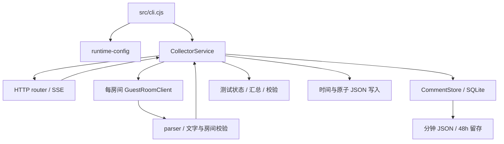

# 架构与实现逻辑

## 分层与依赖

入口负责装配和进程生命周期；HTTP 层处理请求；应用层协调房间、测试与存储；基础设施层实现游客协议与持久化；共享层提供时间和原子写入。

| 模块                                              | 职责                                 | 主要边界                       |
| ------------------------------------------------- | ------------------------------------ | ------------------------------ |
| `src/cli.cjs`                                     | 启动服务、处理退出与异常             | 不解码平台消息                 |
| `src/config/runtime-config.cjs`                   | 加载配置、环境变量与路径             | 本地配置不进入源码提交         |
| `src/application/collector-service.cjs`           | 房间生命周期、测试、恢复、报告       | 通过客户端回调收评论，统一入库 |
| `src/http/router.cjs`                             | 路由、参数、HTTP 错误、SSE           | 不持有平台凭据                 |
| `src/infrastructure/xiaohongshu/guest-client.cjs` | 游客身份、HTTP、WS、超时与重连       | 每个实例仅处理一个房间         |
| `src/infrastructure/xiaohongshu/parser.cjs`       | 惰性解码、文字分类、长 ID、房间过滤  | 无网络和数据库写入             |
| `src/infrastructure/storage/comment-store.cjs`    | 事务、去重、稳定 ID、查询、JSON 留存 | SQLite 为事实来源              |
| `src/shared/atomic-json-writer.cjs`               | 串行原子快照写入及文件替换重试       | 不让临时文件占用击穿采集回调   |
| `src/shared/time.cjs`                             | 北京时间表示与时间处理               | 内部时刻与外部显示保持一致     |
| `src/index.cjs`                                   | 可复用模块出口                       | 与命令行启动分开               |
| `src/server.cjs`                                  | 原入口的薄兼容层                     | 不继续堆叠业务实现             |

测试通过依赖注入替换网络和时钟。项目采用 CommonJS，使用 Node.js 24 的 `node:sqlite`，无需额外数据库服务。

## 游客会话

游客身份仍包含服务端 UID、Cookie 和短期 WS token。一个房间 ID 本身不足以完成 WS 鉴权。

每个客户端维护独立的 `a1`、`webId`、设备 ID、Cookie、签名会话及临时密钥，不读取浏览器 profile 或登录 Cookie。第三方签名库负责本地请求签名和密钥计算；它并非平台官方 SDK。

1. 激活游客会话，提交客户端公钥。
2. 保存服务端 Cookie，并处理会话签名所需的密钥交换结果。
3. 查询游客信息，仅在服务端明确返回 `guest=true` 后继续。
4. 用同一身份取得短期 WS token。
5. 建立 WS，依次确认登录、业务注册和房间订阅 ACK。

网络异常或短时签名错误不立即更换身份；明确身份失效才重建。发现非游客或异常 UID 变化时拒绝继续，避免静默切换身份。不同房间的身份隔离属于会话隔离，不是进程或网络出口隔离；它们仍共享宿主 IP 和事件循环。

## WS 状态机与消息处理

流程为 `LOGIN → BIZ_REGISTER → JOIN_ROOM`，每步匹配消息 ID 与成功 ACK。单纯 WS 握手成功不代表已进房；进房成功也不代表已收到文字评论。

传输和业务心跳默认每 15 秒发送。HTTP/信令超时默认 15 秒；看门狗检测最后帧和心跳 ACK，持续失活后结束旧连接。重连使用带抖动的退避，通常保留同一游客身份、重新取得 token；关播返回单独记录并等待重开。

主要广播在外层 SYNC 中携带 Base64 JSON，再由 `customData` 取文字。解析器仅将已识别的 `text` 消息转为评论；商品、状态、进场等消息不能代替文字验收。逐条错误不丢弃同批其他合法消息，缺少或不匹配的房间 ID 拒收。长整数保持字符串，避免 JavaScript 精度损失。

SYNC 协议应答与存储回调分开。回调失败记录为错误，重复入库不会重复发 SSE。原始协议帧可能包含身份信息，默认关闭，不应随公开问题报告上传。

token 到期信息用于观察，每次重连获取新 token；在线连接跨 token 有效期的持续续期尚未完成实测。

## 存储、去重与 ID

SQLite 使用 WAL。每条新评论在事务内执行：

1. 按业务房间、平台房间与上游 ID 检查重复。
2. 生成 `max(接收毫秒时间戳, 该业务房间上次 ID + 1)` 的字符串 ID。
3. 保存评论、推进最后 ID、标记分钟导出任务并提交。
4. 维护任务将待导出分钟写成 JSON，失败时保留待导出状态。

上游重复消息返回原记录，ID 在重连、重启和重叠窗口中稳定。缺少上游 ID 时不根据昵称和内容猜测重复，因为同样文字可能是不同真实发送。跨房间以 `(room_number, id)` 定位记录。

评论固定包含 `user_id`、`user_name`、`content`、`id`、`received_at`。房间信息放在外层包装；数组导出由文件名区分房间。`received_at` 是本地接收时刻的 `+08:00` 表示，不是经过证明的观众发送时刻。

分钟 JSON 写入与 SQLite 提交不是同一原子事务；JSON 暂时滞后时数据库仍是事实来源。SQLite 同步操作、解码和导出共享事件循环，高消息率或慢磁盘会增加延迟。

## 留存、窗口与导出

默认保留 48 小时。查询立即屏蔽过期评论；每 10 秒维护物理清理与分钟导出，边界分钟重新导出尚未过期的记录。数据库文件删行后不保证立即变小。事件日志、测试报告和手工导出不受此评论留存策略管理。

窗口查询使用 `[video_start - preroll_seconds, video_end)`，默认冗余 300 秒，并提供分页。时间范围描述请求条件，不代表这些时间均在线。服务没有视频采集能力，下游应使用自己的准确切片时间查询，再嵌入下游请求。

离线导出脚本按房间生成 JSON 数组，通过 SQLite 查询并保留原 ID 与北京时间；无评论房间导出 `[]`。已超过留存期的评论无法由导出脚本补回。

## 截止与进程恢复

有时限测试保存绝对 `stop_at`，服务自身设置截止定时器；外部状态检查不会控制截止。到期关闭测试客户端、刷新缓存并生成校验报告。单独 API 进程可以继续提供历史查询。

监督脚本只管理自己创建的子进程，最多恢复 5 次，保留本轮编号和原截止。恢复依据持久化测试标记和 SQLite，不重新开一轮。关闭房间的配置在重启后继续生效。

异常退出前的开放订阅区间按最后记录帧保守封口，并记录恢复缺口。已入库评论保留，停机或网络断线期间没有历史补拉，无法承诺无漏收。

## 验证与指标口径

共同窗口是全部被测房间有效订阅区间的交集。并发文字验收要求独立游客身份、每房间在共同窗口内有真实文字；有房间没有订阅或没有文字时，不能宣称全部并发通过。

`rooms[].test_comments` 是本轮数量，`client.comment_count` 是当前进程客户端数量，缓存数量是当前留存期数量，三者不可互相替代。关播响应次数含多次重试，不能视为发生了同样次数的独立关播。正常停止也会关闭 WS，不应全部计作服务端踢出。

资源指标为进程采样峰值 RSS、累计 CPU 和单核 100% 口径平均 CPU；WS 字节是应用负载，不含 TLS/TCP、视频和浏览器流量。服务重启前后的采样范围不同，最后快照不代表完整全程峰值。实测范围见 [验证记录](validation.md)。

## 优势与限制

| 方面     | 优势                                | 限制                                   |
| -------- | ----------------------------------- | -------------------------------------- |
| 资源     | 无浏览器渲染和视频解码              | 高消息率仍消耗 CPU、SQLite 与磁盘      |
| 身份     | 每房间独立游客会话                  | 宿主 IP 共享，多路平台限制尚未全面验证 |
| 实时交付 | 直接接收推送，可通过 SSE 交付       | 没有断线历史补拉，完整性不能保证       |
| 持久化   | 事务去重、稳定 ID、导出可重试       | 同步 SQLite 与采集共享事件循环         |
| 维护     | 协议、存储、应用、HTTP 分层         | 非官方协议和签名变化需持续维护         |
| 视频衔接 | 前置 5 分钟窗口、分页和重复 ID 一致 | 不包含录制、切片及实际同步联测         |
| 部署     | 单进程、多房间、本地 API、容器路径  | 管理 API 无内置鉴权，房间不是独立进程  |
